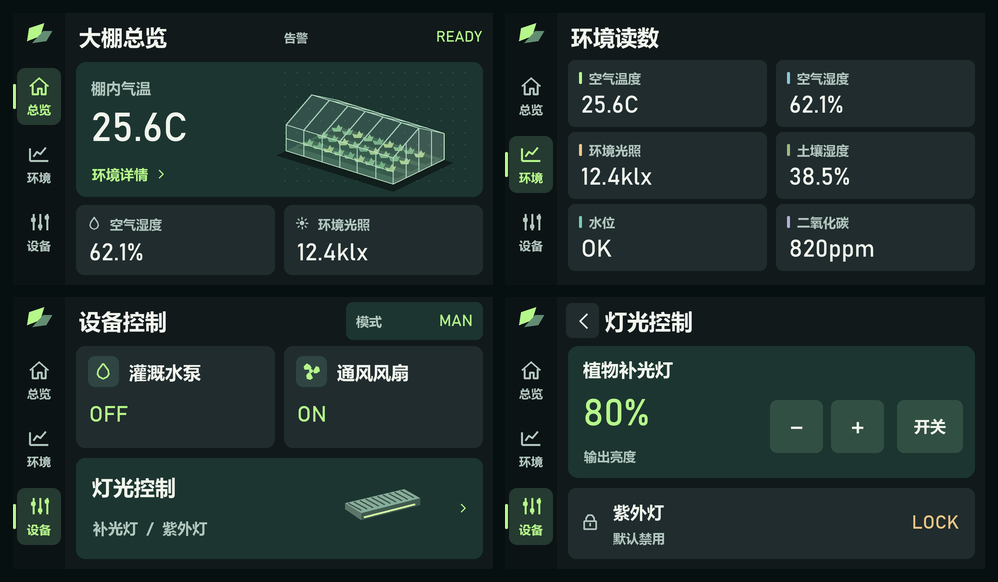

# tjc-hmi-toolkit

基于 Python 的陶晶驰 USART HMI 工程分析与模板生成工具，包含 480 × 272 温室监控四页界面示例。



支持解析资源目录、导出资源、检查页面 CRC、读取控件和事件，并将布局 JSON 与背景图写入已有模板，生成可继续编辑的 `.HMI` 工程。

当前验证对象为 TJC4827T143 相关工程样本。生成的工程需要通过官方 USART HMI 工具打开、编译，再进行屏幕实测。

## 安装

需要 Python 3.10 或以上版本。从仓库根目录运行。

```bash
python -m venv .venv
```

Windows PowerShell 激活环境。

```powershell
.\.venv\Scripts\Activate.ps1
python -m pip install -e .
```

macOS 或 Linux 激活环境。

```bash
source .venv/bin/activate
python -m pip install -e .
```

依赖为 Pillow。资源解析及 CRC 算法使用 Python 标准库。

## 查看和检查工程

```bash
tjc-hmi inspect local/template.HMI --output generated/inspection.json
tjc-hmi export local/template.HMI --output generated/resources
tjc-hmi validate local/template.HMI
```

对本仓库温室布局增加页号、动态字段、导航、设备帧和背景图检查。

```bash
tjc-hmi validate generated/greenhouse.HMI --greenhouse --pictures
```

命令成功返回 0，处理失败返回非零退出码。也可以使用 `python -m tjc_hmi` 调用相同入口。

## 生成温室工程

准备两个本地文件。

- `local/template.HMI` 提供适配目标屏幕的工程配置、页面槽位、字库和图片槽位。
- `local/controls.HMI` 提供页面、文字、透明触摸热区三类控件结构，对应类型 `y`、`t`、`m`。可以使用含有这些控件的兼容工程。符合条件时，两个参数可指向同一个文件。

本次本地验证使用原厂模板作为 template，已有四页工程作为 controls-template。控件模板与目标工程的兼容性需要结合型号和官方编译确认。

```bash
tjc-hmi build --template local/template.HMI --controls-template local/controls.HMI --layout examples/greenhouse/layout.json --output generated/greenhouse.HMI
```

生成器保留模板的资源槽位和相关目录，在槽位内写入页面和配套图片，更新页面校验。超出槽位容量时给出错误。输出经过内部结构、四页协议及图片像素一致性检查后保存，输出路径与模板路径须不同。

示例页面包括总览、环境、设备和灯光。浏览器打开 `examples/greenhouse/preview.html` 可操作交互预览。布局调整以 `layout.json` 为准，预览为本次界面的固定快照，修改配置后需要同步更新预览。

字体通过 `fields[].font` 指定目标模板中的字体 ID。`size` 表示设计稿字高。示例的字体 ID 0、1 来自本次模板，使用其他字库时应调整配置。

## 测试

```bash
python -m unittest discover -s tests -v
```

默认 24 项测试使用运行时创建的合成工程，覆盖损坏输入、资源边界、控件回写、CRC、图片编码、CLI 和完整生成流程。生成流程还检查重复执行的字节一致性。

安装 Node.js 后可运行预览测试。

```bash
node tests/preview_test.cjs
```

本机真实样本生成和检查的结果见 [测试记录](docs/testing.md)。官方重新编译与硬件联调的验证范围见 [兼容性说明](docs/compatibility.md)。

## 目录

```text
src/tjc_hmi/            Python 包与命令行
examples/greenhouse/   布局、背景图及交互预览
tests/                 合成工程与预览测试
docs/                  文件结构、兼容性、测试和来源记录
```

代码来源和许可证状态记录在 [来源说明](docs/provenance.md)。项目的开源许可证由仓库所有者确定。

